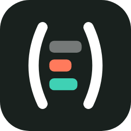
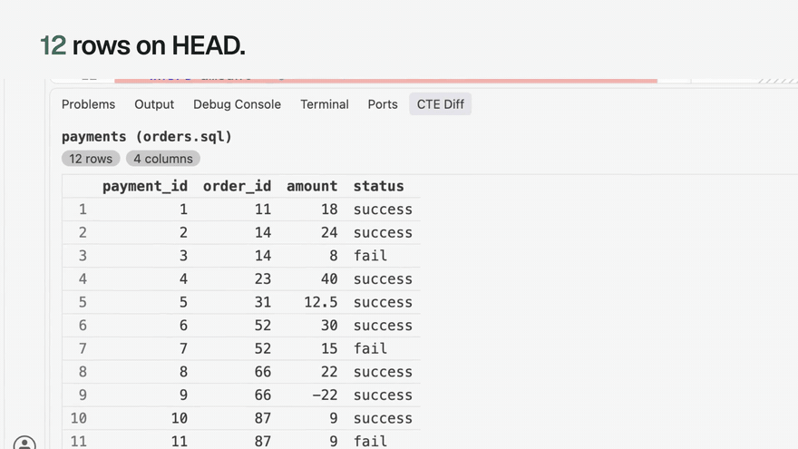
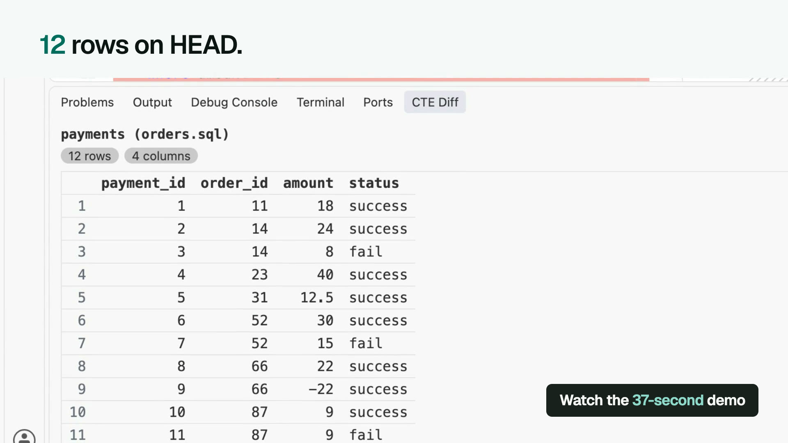
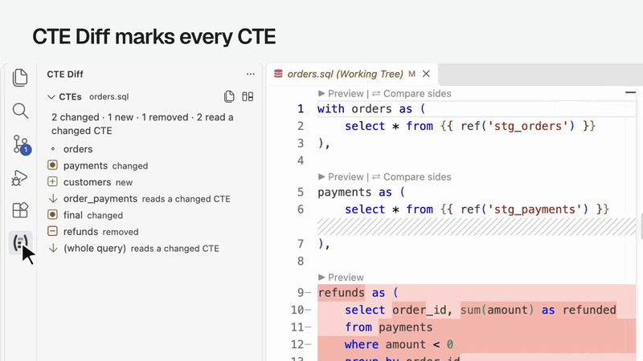
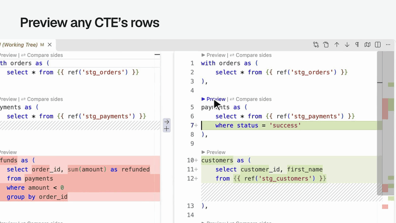
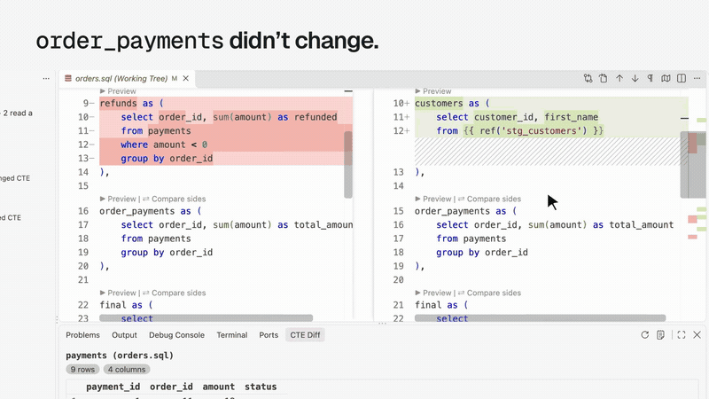
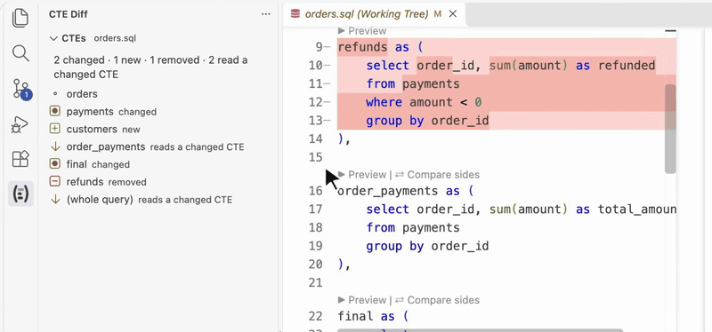
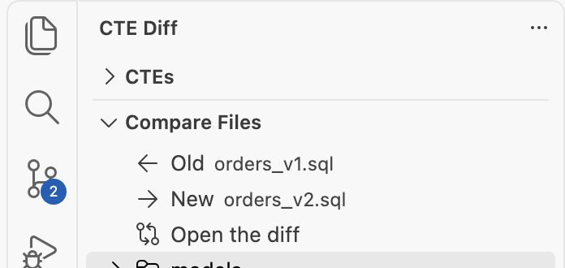
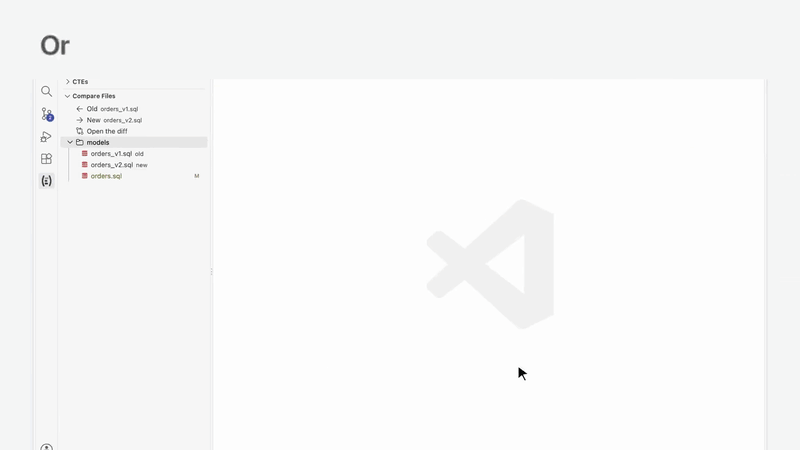

  

<h1 align="center">CTE Diff</h1>

  <b>See what a dbt change did to the data, one CTE at a time.</b> 
  A VS Code extension that previews any CTE's rows, and compares a CTE across both sides of a diff, through <code>dbt show</code>.

  
  
  
  
  

  <a href="https://ctediff.dev/">Docs</a> ·
  <a href="https://ctediff.dev/playground/">Playground</a> ·
  <a href="https://github.com/MarkPhamm/cte-diff/blob/main/CHANGELOG.md">Changelog</a> ·
  <a href="https://marketplace.visualstudio.com/items?itemName=MarkPhamm.cte-diff">VS Code Marketplace</a> ·
  <a href="https://open-vsx.org/extension/MarkPhamm/cte-diff">Open VSX</a>

  

  <em>Preview payments on HEAD (12 rows) and on the working tree (9). Then compare the old file with the new one. <a href="https://ctediff.dev/playground/">Try it in your browser →</a></em>

  

## Why

A git diff's left side is HEAD. Its right side is the working tree. dbt Power User's Execute CTE only runs on the right.

CTE Diff previews the same CTE on both. `payments` on HEAD returns 12 rows. On the working tree, after `where status = 'success'`, it returns 9.

When the old logic and the new logic are two files, Compare Files opens them. Compare sides on `payments` lists the three failed payments, only in the old file.

On `dev` and want to check against `qa`? Compare with Branch opens `qa`'s version on the left and your working tree on the right. Compare sides on `order_payments` lists three totals that changed. Queries run in your dbt project.

## Quick start

1. Install **CTE Diff** from the [VS Code Marketplace](https://marketplace.visualstudio.com/items?itemName=MarkPhamm.cte-diff), or from [Open VSX](https://open-vsx.org/extension/MarkPhamm/cte-diff) for Cursor, Windsurf and VSCodium.
2. Open a dbt project. It needs dbt Fusion or dbt-core 1.5 or later, with a working profile.
3. Open a changed model as a diff. Click **▶ Preview** above a CTE on the left, then on the right.
4. To compare with another branch, such as `qa`, click **Compare with Branch…** in the **CTE Diff** sidebar's title bar and pick the branch.
5. To compare two files, open the **CTE Diff** sidebar, set **Old** and **New**, click **Open the diff**, then **⇄ Compare sides**.

Diff editors hide the **▶ Preview | ⇄ Compare sides** buttons above each CTE unless `"diffEditor.codeLens": true` is in your settings. The sidebar and the editor's title bar work either way.

No warehouse at hand? [`examples/duckdb`](https://github.com/MarkPhamm/cte-diff/tree/main/examples/duckdb) is a small dbt project on a local DuckDB file.

## What it does

### Marks every CTE of both sides

- **changed**: its text changed.
- **new** or **removed**: it's only on one side.
- **reads a changed CTE**: the same text, but it reads one that changed, so its rows can still differ.

Hover a CTE for **←** (preview the old side), **→** (preview the new side) and **⇄** (compare both). Click it to jump to it.

### Previews any CTE or subquery

**▶ Preview** above a CTE shows its rows, on either side of a diff or in any SQL file. The last button previews the whole query.

**▶ Preview subquery** above an `exists`, `in`, scalar or derived-table subquery shows its rows too. A correlated subquery, one that reads an outer alias such as `renamed.game_id`, runs with the outer relations it reads, so the reference resolves as it does in the model. The preview keeps the outer tables, not the outer query's join conditions or other filters, so with several outer tables it can show rows the full query would filter out.

A CTE inside another CTE's `with` gets **▶ Preview** and **⇄ Compare sides** like any other, and the sidebar lists it under the CTE that holds it. Each `select` of a `union`, `intersect`, `except` or `minus` gets **▶ Preview branch**, to see which branch brings in a row.

### Compares a CTE on both sides

**⇄ Compare sides** runs the CTE on both sides and lists the rows only one side returns, with each side's row count. A changed row shows as a pair, old above new, with the changed cells highlighted. Rows pair up on their id columns: `id`, or a name ending in `_id`, `_key`, `_pk` or `_sk`.

Columns match by name, not position. An added, dropped or renamed column shows as a difference, not an error:

### Compares any two files, or two pasted queries

- **Compare Files**, below the CTEs: put two SQL files of the workspace in **Old** and **New**, then click **Open the diff**.
- **CTE Diff: New Comparison (Paste Two Queries)**: paste an old and a new query side by side.

### Compares a file with another branch

- **⑂** beside a file in **Compare Files**, or **Compare with Branch…** in the sidebar's title bar: pick a local or remote branch. Its latest commit goes on the left, your working tree on the right.
- Both sides run on your one dbt target, so the comparison shows what the SQL changed, not what another environment holds.

### Compares the compiled SQL

**Compare Compiled SQL** opens a diff of what dbt renders for each side: the Jinja, `ref`s, sources and macros resolved. Nothing runs on the warehouse, so it costs no query. When a diff is open it is the first row of the CTE Diff sidebar, and a button in that sidebar's title bar, as well as in the diff's title bar. After **Compare with Branch**, that is the branch's compiled SQL against your working tree's.

## How it works

Each side's CTE becomes `select * from <cte>`, keeping the CTEs before it. Both sides run in one query through `dbt show --inline`, in your dbt project. So Jinja (`ref`, `source`, macros, `var`) renders as in a real run, and dbt connects with your profile: key-pair, SSO and password logins all work. If the project has a `.env` file, its variables are loaded first.

On Snowflake, DuckDB and BigQuery, rows become JSON and the query takes `left EXCEPT right` and `right EXCEPT left`, plus each side's row count. Snowflake and DuckDB sort the keys; BigQuery keeps column order. Redshift diffs the rows themselves, with no counts. Results open in the **CTE Diff** tab of the bottom panel, and each run is logged to **Output › CTE Diff** with the exact SQL. [How the comparison works →](https://ctediff.dev/comparison/)

## Requirements

- dbt Fusion, or dbt-core 1.5 or later (both have `dbt show --inline`), with a working profile. **CTE Diff: Check Setup** runs `dbt debug` and shows what it finds.
- Comparisons run on BigQuery, DuckDB, Redshift and Snowflake; dbt picks the SQL for your adapter. On another warehouse the panel says so, with a link to ask for it. Previews run on any warehouse dbt supports. On Redshift the comparison has no row counts, and its columns must line up on both sides: adding, dropping, renaming or reordering a column errors there instead of showing as a difference. On BigQuery a reordered column list shows as a difference.
- A trusted workspace: dbt runs the project's macros.

## Settings

| Setting | Default | |
|---|---|---|
| `cteDiff.dbtPath` | empty | Path to `dbt`. Empty: the project's `.venv`, `~/.local/bin`, Homebrew, else `PATH`. |
| `cteDiff.projectDir` | empty | The dbt project to run in. Empty: the project holding the file, else the one in the workspace. |
| `cteDiff.target` | empty | The dbt target (`--target`). |
| `cteDiff.dbtArgs` | empty | Extra arguments for every dbt run, such as `--vars`. |
| `cteDiff.limit` | `100` | The most rows a preview fetches, and the most differing rows a comparison lists. |

## FAQ

**I don't see ▶ Preview or ⇄ Compare sides in a diff.** VS Code hides CodeLens in diff editors. Add `"diffEditor.codeLens": true` to your settings, or use the sidebar or **⇄ Compare a CTE…** in the editor's title bar.

**Does it send my data anywhere?** No. dbt runs on your machine with your profile, and the rows go from your warehouse to the panel. The extension collects no telemetry.

**What does a comparison cost?** One query per click, which scans what the CTE scans, on both sides. `cteDiff.limit` caps the rows returned, not the rows scanned.

**The counts differ, but no rows are listed.** `EXCEPT` compares distinct rows. When only duplicates differ, the counts show it and the rows don't.

**Which dbt does it run?** `cteDiff.dbtPath` when it's set. Otherwise the project's `.venv`, then `~/.local/bin`, Homebrew, and `PATH`.

[More questions, and the known limits →](https://ctediff.dev/faq/)

## Contributing

Bugs and ideas go in [GitHub issues](https://github.com/MarkPhamm/cte-diff/issues). To build and test the extension, see [Development](https://ctediff.dev/development/).

## License

Apache-2.0. Made by [Minh (Mark) Pham](https://github.com/MarkPhamm).
