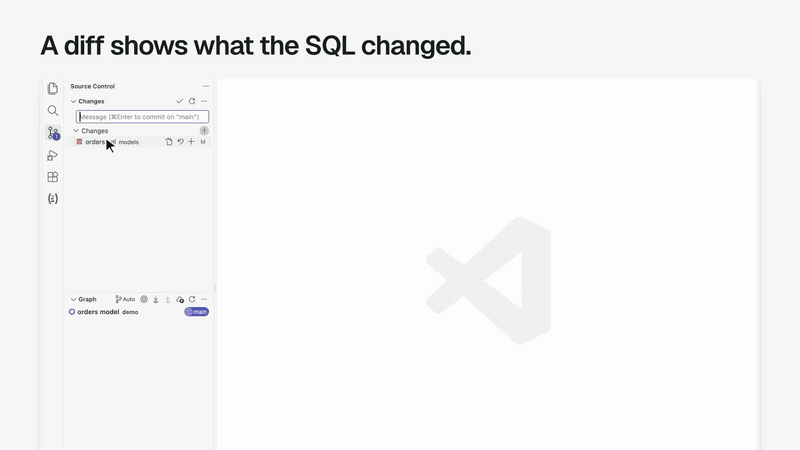
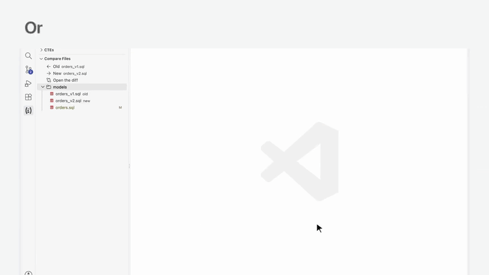
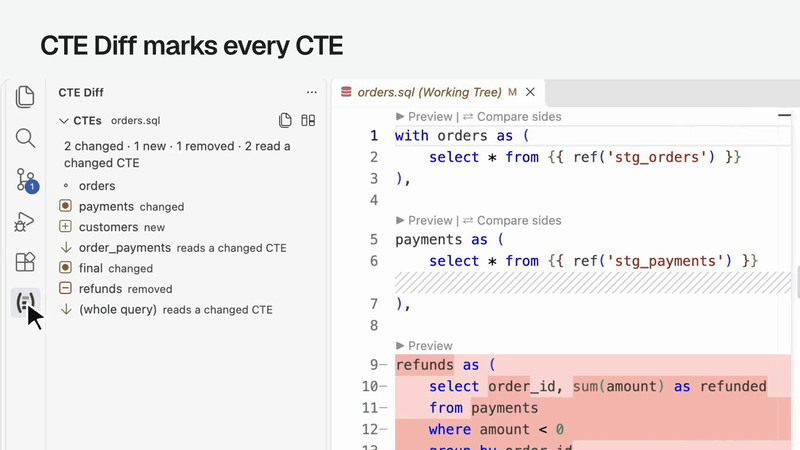
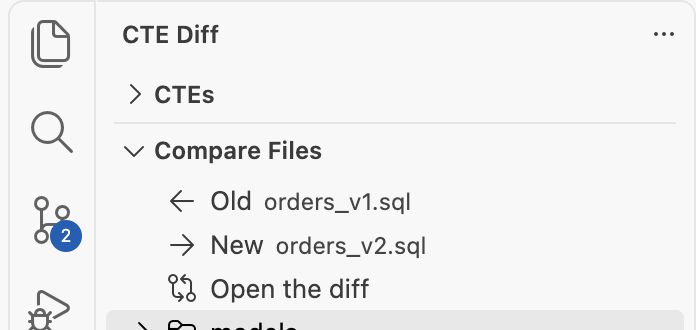
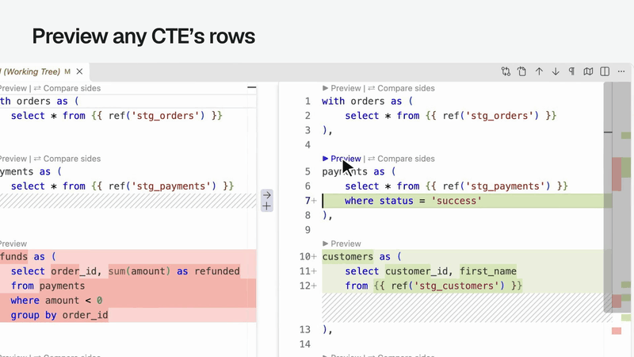
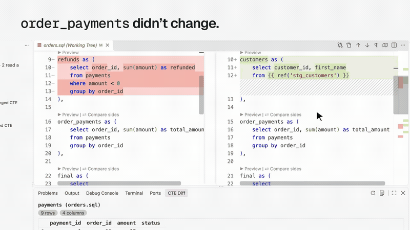
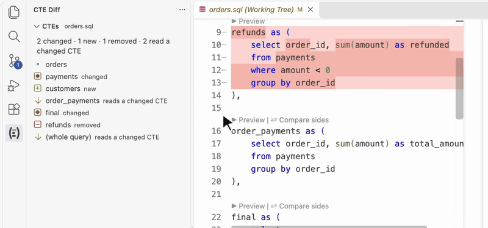

# Use it

Reviewing a change to a dbt model? Open the two versions in a diff editor and click above any CTE:

- **▶ Preview** shows that CTE's rows, on either side.
- **⇄ Compare sides** runs the same CTE on both sides and shows the rows only one side returns, with row counts.

You see what the change did to the data, CTE by CTE, without copying SQL into a worksheet.

{ width="100%" }

## Open a comparison

- **A git change:** open the model from Source Control. Click **⇄ Compare a CTE…** in the editor's title bar and pick a CTE. Diff editors hide the buttons above each CTE unless `"diffEditor.codeLens": true` is in your [settings](settings.md); CTE Diff offers to turn it on the first time a SQL diff opens, and the title bar and the sidebar work either way.
- **Another branch:** click **⑂ Compare with Branch…** in the sidebar's title bar, or run **CTE Diff: Compare with Branch…**, and pick a branch. The open SQL file opens in a diff with that branch's latest commit on the left and your working tree on the right. With no SQL file open, it asks for one first. Remote branches are as of your last `git fetch`.
- **Any two files:** in the sidebar's **Compare Files**, set **Old** and **New**, then click **Open the diff**. Or run **CTE Diff: Compare Two Files…** and pick the old file, then the new one.
- **Pasted SQL:** run **CTE Diff: New Comparison (Paste Two Queries)** from the Command Palette, or click its button in the sidebar's title bar. Paste the old query on the left and the new one on the right.

{ width="100%" }

Every SQL file also gets **▶ Preview** outside a diff. The last button previews the whole query. Outside a diff, the title bar's button is **▶ Preview a CTE…**.

Every subquery gets **▶ Preview subquery** too: an `exists`, `in`, scalar subquery or derived table. A correlated subquery runs with the outer relations it reads, so an outer alias such as `renamed.game_id` resolves as it does in the model. The preview shows the subquery's own select list, not the outer query's rows. It keeps the outer tables, not the outer query's join conditions or other filters, so with several outer tables it can show rows the full query would filter out.

A CTE inside another CTE's `with` gets **▶ Preview** and, in a diff, **⇄ Compare sides**, like a top-level one. Its preview keeps it inside the CTE that holds it, so names resolve as they do in the model.

Each `select` of a `union`, `union all`, `intersect`, `except` or `minus` gets **▶ Preview branch**, in a CTE, the final query or a subquery. It runs that one `select` with the CTEs it reads. An `order by` or `limit` after the last branch sorts the whole set, so the last branch's preview leaves it out.

## Compare the compiled SQL

**Compare Compiled SQL** shows what dbt renders for each side as a diff of its own. When a diff is open it is the first row of the CTE Diff sidebar, and a button in that sidebar's title bar. It is also in the diff's title bar and the Command Palette. `dbt compile` resolves the Jinja, `ref`s, sources, macros and `var`s, so you see the SQL that would reach the warehouse, not the SQL as written. Nothing runs on the warehouse.

After **Compare with Branch**, the left side is the branch's compiled SQL and the right is your working tree's, so you can see exactly what the branch's Jinja became next to yours. Each side compiles with its own macros, so a change to a macro alone shows up too.

## The sidebar

Click the **CTE Diff** icon in the Activity Bar. It lists the CTEs of the SQL you're on.

When that SQL is one side of a diff, it lists every CTE of both sides, marked:

- **changed**: its text changed.
- **new** or **removed**: it's only on one side.
- **reads a changed CTE**: the text is the same, but it reads one that changed, so its rows can still differ.

{ width="100%" }

Hover a CTE for its buttons: **←** previews the left (old) side, **→** previews the right (new) side, and **⇄** compares both. Hover its name for what the mark means. Click a CTE to jump to it. A CTE lists the CTEs of its own `with` under it, each with its own mark. A CTE with subqueries expands to list them: click one to jump to it, or hover it for **▶** to preview its rows. In a diff, a changed or affected CTE lists its old and new subqueries; one that didn't change lists a single side.

Below the CTEs, **Compare Files** opens any two SQL files of the workspace side by side. **Old** starts as the file you open; click **Old** or **New** to pick another, or hover a file in the list below and click **←** (use as old) or **→** (use as new). Then click **Open the diff**. A file's **⑂** compares it with a branch.

{ width="100%" }

You can try the marking, and the rows, in the [playground](playground.md). It runs the same parser and the same SQL.

## The results

Results open in the **CTE Diff** tab of the bottom panel, beside the Terminal. Under each heading: the files, the dbt target and how long the run took.

- A preview shows the rows, up to [`cteDiff.limit`](settings.md), with the row and column counts.
- A comparison shows each side's row count and how many rows are only on the left or only on the right. Then it lists those rows, marked **−** (left, old) and **+** (right, new).
- A row that changed is listed as a pair: its old version above its new one, with the cells that changed highlighted. Rows pair up by their id columns: those named `id`, or ending in `_id`, `_key`, `_pk` or `_sk`, when each id is unique on both sides. Rows with no partner are listed after the pairs.
- When the two sides have different columns, it says which.
- Click a column header to sort the rows by it: ascending, then descending, then back to dbt's order. Click another header to sort by that one, with the earlier one breaking ties. Nothing reruns: the sort acts on the rows already fetched, up to `cteDiff.limit`. In a comparison, a changed row's old and new versions move together, and each group keeps its own rows.

A preview of `payments`, the CTE that changed:

{ width="100%" }

A comparison of `order_payments`, whose SQL didn't change but which reads `payments`:

{ width="100%" }

A comparison of `final`, which gained a column and lost one:

{ width="100%" }

The view's title bar has **Run Again**, which reruns the last preview or comparison after you edit the SQL, and **Show Log**. Each run is logged to **Output › CTE Diff**, along with the exact SQL. A new run cancels the one still going.

When dbt fails, the panel shows dbt's error and a **Check Setup** link. **CTE Diff: Check Setup** runs `dbt debug` with CTE Diff's settings and shows what it found. A new install also gets a walkthrough: **Help › Welcome**, then **Get started with CTE Diff**.
